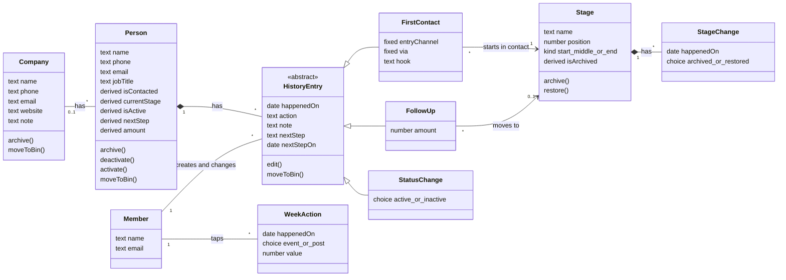
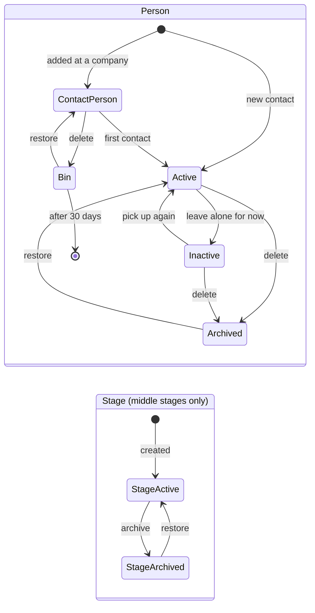

# JAFT design (Just A Funnel Tool)

How JAFT works and why: users and hosting, exports, the data model, the rules, and how the app can change while the database keeps its data. Setup and usage are in the [README](../README.md).

## 1. Users, accounts and hosting

- **Users:** a small team, possibly growing. Everyone sees all data.
- **Roles:** not built. The design keeps room for them: every record stores who created and changed it, and access rules live only in the database.
- **Database:** its own Supabase project.
  - It's in an EU region, on the free plan.
  - It has its own `members` table, linked to Supabase Auth.
  - Self-registration is off; users are invited.
  - Row Level Security is on for every table.
  - **An access list:** logged in isn't enough. Every rule checks "logged in and on the list" (`members.allowed`, through the function `is_allowed()`). A new account starts off the list, so a mistake with accounts or the sign-up switch gives someone a login but no data. Users can change only their own name, never `allowed`; access is given in the database by the owner. The app shows a "no access" message to someone who is logged in but not on the list.
- **Accounts:** no account management in the app. All login code stays in one small part of the data layer (`data-supabase.js`), so it can later be replaced by a shared login library.
- **Swappable database:** the app talks to one data layer. It runs on local storage for testing, and on Supabase in production, behind the same functions.
- **Which one follows from the address, not from a setting.** Only on the live address (`productionHosts` in `config.js`) does the app use Supabase. Everywhere else (localhost, the local network, a file) it uses local data, so testing can never reach the real database by accident.
- **Hosting:** a static site with no build step, for example on GitHub Pages.

## 2. Backups and exports

- **Backup export** (Instellingen): everything, exactly as stored, as one JSON file. The page shows the date of the last export. The free Supabase plan has no restorable backups, so this is the safety net.
- **Restoring:** `tools/restore.html` turns a backup into an SQL script for the SQL Editor. It runs as the database owner, so ids, dates and "created by" come back exactly, bin and archive included. It is one transaction, and it stops unless the database is at the expected version and holds no data yet, so a restore never mixes old and new. Older backups are first upgraded with the same steps as the local data. Users are not in it; "created by" only points to users that exist.
- **Analysis export** (Overzicht): one JSON file meant to be read by an AI.
  - It has one block per contact, with its history in date order, readable labels instead of codes, and calculated values such as current fase and days between fases.
  - It includes contact persons not yet contacted, companies with their website, note and creation date, every status change, every planned next step with whether it slipped, and the export date.
  - All free text is included as typed.
  - **Phone and e-mail are left out.** Company names are kept so the AI can look up the type of company.
- **Free text over structured fields:** extra structured fields add friction on input, and the AI reads the notes afterwards.

## 3. Language

- **Code, database, identifiers and fixed values are English.**
- **The interface is Dutch.** All interface text lives in one translation file (`nl.js`), and the code only uses keys. A second language later means adding a file, not changing code.
- **What users type is data** (names, notes, the names of in-between fases) and stays as typed.

## 4. Domain model

### Classes

`derived` means the value is never stored; it's calculated from the history entries.

### Database tables

What each table in the database holds. The schema is in `migrations/`.

| Table | Holds |
|---|---|
| `members` | The users, one row per login. Created automatically when a user is added in Supabase. `name` is what the app shows at the top right; `allowed` is the access list (off for a new account). |
| `companies` | Companies with their general details. Archived and binned companies stay in the table, marked by `archived_at` or `deleted_at`. |
| `persons` | Everyone: contact persons not yet contacted, and contacts. A person is a contact once it has a first-contact row in `history_entries`. |
| `history_entries` | One row per save on a person: the first contact, every follow-up (action, note, the **stage chosen**, amount, next step) and every switch to active or inactive. **A contact moving to another stage is stored here**, in `stage_id`. |
| `stages` | The stages themselves: Contact and Opdracht (fixed) and the middle stages managed in Instellingen, with their name and position in the funnel. |
| `stage_changes` | **Not** contacts changing stage. This is the archive history of the stages themselves: one row each time a middle stage is archived or restored in Instellingen, with the date. Empty until you archive a stage. The overview uses it to know in which weeks a stage was active. |
| `week_actions` | One row per tap on the events +/− and the LinkedIn post in the overview, stored by date. |
| `app_settings` | Shared settings changed in Instellingen. For now only the first day of the week. |
| `schema_migrations` | Which migrations have run. The app checks the highest number at startup. |

### Lifecycles

Restoring an archived person brings back the status it had, active or inactive.

## 5. Rules

### History

- **The state is calculated, never stored.** A person's current stage, active status, next step and amount come from its history entries, always in order of the date things **happened** (`happenedOn`). The entry moment only breaks ties on the same day. The same entries always give the same result, whatever order they were entered, backfilled, corrected or deleted in.
- **Two dates per entry:** `happenedOn` (used for every count) and the moment it was entered (`created at`).
- **Who and when:** every record stores `created by/at` and `changed by/at`.
- **Corrections overwrite the entry.** There's no correction trail.
- **Valid entries only:**
  - an entry must contain something (an action, stage, next step or note)
  - `happenedOn` can't be in the future
  - a next step's date comes after the entry's date
  - nothing is dated before the first contact, and the first contact isn't dated after any other entry
- **The first-contact entry can't be deleted on its own.** To remove it, archive the person.

### Stages (fases)

- **Contact** is the first stage. It's fixed, can't be archived, and every new contact starts in it.
- **Opdracht** (key `order`) is the last stage. It's fixed and can't be archived; it adds the field *amount*.
- **Middle stages** (initially Gesprek and Offerte) are managed in Instellingen: add, rename, reorder, archive and restore. **Never deleted.**
- **Reordering** writes only the stages whose position changes (usually two). Equal positions, left by an interrupted move, are ordered by id, so the order is always the same, and the next move repairs them.
- **Every history entry** has the same base fields, whatever the stage: when, action, note and an optional next step. Amount appears only for Opdracht.
- **Choosing a stage:** the form shows the stages with the person's current stage selected. Leaving it selected means the entry doesn't change the stage. When correcting an old entry, the selection starts at the stage the person was in just before it, or at the stage the entry set.
- **Free flow:** every *active* stage can be chosen at any time, so going back, going forward and skipping are all allowed. An archived stage can be left, but not chosen. Contacts that are in an archived stage stay there until moved.
- **Counting:** a stage counts once each time a person **enters** it from a different stage. Staying in the same stage doesn't count, and skipped stages don't count. Offerte → Gesprek → Offerte counts as two Offertes.
- **Overview:**
  - **Weeks:** a stage is shown in a week if it was active on at least one day of that week. This is why archiving and restoring are kept with their dates (`StageChange`).
  - **Totals:** only stages that aren't archived are shown.

### Deleting, archiving, inactive

| You delete | What happens |
|---|---|
| A history entry | Bin, restorable for 30 days, then gone |
| A contact person (not yet contacted) | Bin |
| A company with no persons | Bin |
| A company with persons | **Archive.** The confirmation lists the linked contacts and contact persons, which are archived together with it. |
| A contact | **Archive** (a contact is never empty) |

- **Archived means deleted for the user:** it's invisible, it isn't counted in the overview or the analysis export, and it can be restored from the Archief in Instellingen.
  - Things archived together are restored together.
  - Restoring a contact whose company is archived also restores the company.
- **Inactive means "leave alone for now":** the person stays findable with the filter, keeps counting, and can be reactivated.
- **Deleting always asks for confirmation** in a popup, and offers Ongedaan afterwards.
- **One place hides deleted and archived records:** the data layer doesn't load them. Only the Bin and the Archief ask for them.

### Next step

- **One open next step per person:** the most recently planned one.
- **It closes when:**
  - an action is done on or after its planned day, or
  - an action is done before its planned day **and** a new next step is planned (the new one replaces it).
- **It stays open when:**
  - an action is done before its planned day without a new step
  - only a note is added
  - only the stage changes

### Entry channels and via options

- **Both are fixed in the code** (one list each in `config.js`) and can't be changed in Instellingen.
  - Entry channels: `hook` (Haakje), `linkedin` (LinkedIn), `cold` (Koud).
  - Via options: `event` (Event), `referral` (Doorverwijzing), `other` (Andere).
- **Only Haakje asks for via and the hook text.**
- **The key is stored, never the label.** The Dutch labels come from the translation file.
- **Entry channel, via and hook text are stored on the first-contact entry,** because they describe how that first contact came about.

### Overview percentages

- **"In totaal":** between two adjacent stages in funnel order, the percentage is the later stage's count divided by the earlier stage's count. For example, X contacts and Y gesprekken gives Y as a percentage of X.
- **Counts follow the counting rule above:** entries into a stage, over all time, for non-archived stages only.
- **Above 100% is possible:** because stages can be skipped or entered more than once, a later stage can exceed an earlier one. That's shown as is.

### Identity

- **No field is an identifier.** Everything is linked by a generated id. Two companies or two people can have the same name.
- **Duplicates get a warning, never a block:** "already exists, open that one / save as new anyway". Suggestion lists show extra details (website, company, phone) to tell duplicates apart.

### Weeks

- **JAFT knows no plan or period.** Any date up to today can be entered. The overview runs from the week of the first activity to this week, and what a stretch of weeks means is up to the user.
- **The first day of the week is a shared setting** in Instellingen. Thursday is the default (in `config.js`), because Wednesday ends with the meeting and the planning.
- **Only the view depends on it.** Everything is stored by date, and weeks are calculated when the overview is shown. Changing the first day regroups the weeks, and nothing in the data changes.

### Week actions

- **Stored by date, not by week:** a tap for the current week is stored on the day of the tap; a tap for an earlier week on that week's first day. It counts for whatever week contains that date, so changing the first day of the week regroups it like everything else.
- **Compared fairly:** like stages and new contacts, the current week's events are compared with last week up to the same weekday.
- **Events:** a +1 / −1 counter per week. Each tap is its own record, so two users tapping at the same time never lose a tap.
- **LinkedIn post:** a checkbox per week; the latest tap decides.
- **Both are for the team, not per person.** Each record keeps who tapped.

### Versions and changes

The app can change while the database keeps its data. These rules keep a running, filled database correct:

- **Migrations.** Every database change is a numbered file in `migrations/` (`001_initial.sql`, `002_…`). Each runs once, in order, and records itself in `schema_migrations`. A migration that has run is never edited; a fix is a new file.
- **Only additive changes in one step.**
  - A new column gets a default, so existing rows stay valid.
  - Renaming or removing goes in two releases: first add the new and copy the data over, then remove the old in a later release.
- **The version check.** `version.js` holds `SCHEMA_VERSION`, the migration number this code needs. At startup the app compares it with the database. If they differ, it loads and saves nothing:
  - **Database older:** the app says the migration still has to run.
  - **Database newer:** the app says this copy is outdated, for example a phone with a cached version, and offers to reload.
- **The local version follows the same steps.** `data-local.js` has one upgrade step per migration (`LOCAL_MIGRATIONS`), so local test data and imported backups are upgraded the same way as the real database.
- **Calculated, not stored.** Stage, next step, active status and all counts are recalculated from the history. Changing such a rule needs no data migration, but it also changes how past weeks are counted. That's intended, but worth knowing.
- **Test on a copy of real data.** The test page (`tests/load-testdata.html`) loads a backup file into the local version and upgrades it. A new version is tried there first.
- **Two branches:** work is pushed to `dev`; `main` is the published, live version. Going live is merging `dev` into `main`.
- **Release order:**
  1. backup export
  2. run the new migration, if there is one
  3. merge `dev` into `main`
  4. check the version in Instellingen and click through

  Each step can be undone with the backup.

## 6. Interface decisions

- **Correcting history (phone):** swipe a row. Swipe left shows *Bewerken*, swipe right shows *Verwijder*.
- **Correcting history (laptop):** a pencil and a × appear when you hover over an entry or reach it with the keyboard.
- **Editing:** the update form below the timeline fills with the entry's values, and the button becomes *Bewaar wijziging*.
- **Deleting:** always a confirmation popup.
- **Instellingen:** opened from your name in the top right, not a tab. It contains the backup export, the look (per device), the first day of the week, stages, the Bin, the Archief, and the app and database version.
- **Look:** three themes, chosen per device in Instellingen. *Orville licht* is the default: the Orville colours and Outfit on a light background; the yellow-green is a fill with dark text on it, links and accent text use a darker olive, and the funnel and the better weeks grow towards the full Orville green (never dark: it should feel like progress). *Orville donker* uses the same colours on dark antraciet. *Neutraal* is a plain light look with a teal-green accent and the system font. All colours are named tokens at the top of `style.css`, so a theme only fills in those tokens. Opdracht stays gold in every theme.
- **Stage choice:** see *Choosing a stage* above.

## 7. Testing

- **A test data set that can be loaded for testing:** a believable history with many contacts, long names, archived stages, and contacts going back and forth and skipping stages.
- **It's part of testing, not of the app:** it's loaded into the local-storage version, and it's never part of the production code path or the Supabase data.

## 8. Possible future

Not built, but prepared for. Each can be added without changing the data that exists by then.

### A second interface language

- **Already in place:** all interface text lives in `i18n/nl.js`, by key, and the code only uses keys.
- **What it would take:** a second file with the same keys (for example `i18n/en.js`), a choice in Instellingen, and `I18N` picking the file.
- **What stays as typed:** what users type (names, notes, the names of middle stages) is data and isn't translated.

### Entry channels and via options managed in Instellingen

Possible for either list or both. What it would take:

- **A table per list** (`entry_channels`, `vias`) like the middle stages: name, position, archived. Never deleted. Archived options keep their old records and can't be chosen for new contacts.
- **A setting per entry channel, "asks for via and hook".** This replaces the flag in `config.js`.
- **Existing records keep working,** because the fixed keys (`hook`, `linkedin`, `cold`, `event`, `referral`, `other`) become the ids of the initial rows.
- **Labels move** from the translation file to the data, like the names of middle stages.
- **The overview and the analysis export** group by whatever channels exist instead of the fixed three. Archived channels follow the same rules as archived stages.
- **Instellingen** gets a section per list, like the stages section.

Already in place to keep this small:

- **Store a key, never a label.** First-contact entries store the channel key and the via key.
- **One list in the code per kind.** The form, the overview and the export read those lists, and nothing else checks for a specific channel or via by name, except through the `asksVia` flag.
- **One place to read them.** Screens get the options and their labels from the Store (`channels()`, `viaOptions()` and their labels), so swapping a fixed list for a table only touches the Store, the data layer and Instellingen.

### A full installable app (PWA)

- **Already in place:** a manifest (`manifest.json`) with name, colours and icon, and the tags for iOS. JAFT can be added to a home screen and opens without the browser bar.
- **What it would take:** a small service worker that keeps only the app's own files on the phone, never the data. JAFT then opens without a connection (to read what's on screen after loading) and installs more easily on Android.
- **The risk:** a kept copy of the app can stay behind after a release. The service worker has to fetch the new version and show a notice ("a new version is ready, reload"); the version check catches a copy that stays too old. Every release then also bumps the service worker's file list.

### Entering data offline

- **What it would take:** saves are kept in the browser while there's no connection, and sent in order once there is. Ids are already created in the app, so a record can exist before the server has seen it.
- **The hard part:** conflicts. A colleague may have changed or deleted the same contact in the meantime. The rules for that (who wins, what the user sees) have to be decided first. This is a much bigger step than the service worker alone.

### Roles

- **Already in place:** every record stores who created and changed it, and all access rules live in the database.
- **What it would take:** a role per member, and Row Level Security rules that check it. The screens only need to hide what a role can't do.
